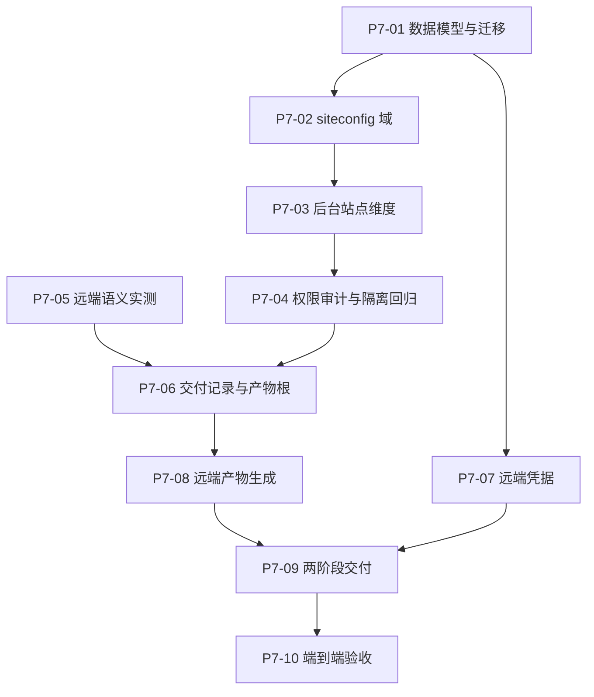

# Phase 7 本地 Tickets

父阶段：无。本阶段为本地新建，**未创建远端 Issue**。

决策依据：[ADR-0009](../adr/0009-site-config-collection-and-remote-delivery.md)（站点配置集合与远端交付目标）。术语依据：[CONTEXT.md](../../CONTEXT.md)（站点配置 / 站点标识 / 交付目标 / 交付记录）。

## 本阶段分为两个可独立验收的交付阶段

ADR-0009 决策五把工作分为一期与二期，边界是**「发布域是否被改动」**：

- **一期：站点配置集合。发布域不变。** 只增加站点维度与后台站点维度；`cms_publish_state`、`cms_publish_task`、`cms_release`、`deployment.Pointer`、`cms_published_article`、`slug_locked_at`、保留策略全部不动。一期出错是模型问题。
- **二期：远端交付目标（首版 Cloudflare Pages）。** 全部为新增（新表、新目录、新交付路径），只改动两处共享代码。二期出错是集成问题。

两期放在同一 phase 目录，是为了让「二期依赖一期」这条边在一处可见。若你希望二期独立成 phase（例如 phase-8），改目录名与编号即可，内容无需变动。

## Tickets

### 一期：站点配置集合（发布域不变）

| Ticket | 本地文件 | 交付行为 | 直接前置 |
| --- | --- | --- | --- |
| P7-01 | [01-site-config-collection-schema.md](01-site-config-collection-schema.md) | 站点配置集合的数据模型与迁移 | 无 |
| P7-02 | [02-siteconfig-domain.md](02-siteconfig-domain.md) | siteconfig 域按站点维度化，local 语义固定为角色 | P7-01 |
| P7-03 | [03-admin-site-dimension.md](03-admin-site-dimension.md) | 管理后台的站点维度与公开地址语义 | P7-02 |
| P7-04 | [04-permission-audit-isolation.md](04-permission-audit-isolation.md) | 权限、审计与多站点隔离回归 | P7-03 |

### 二期：远端交付目标（首版 Cloudflare Pages）

| Ticket | 本地文件 | 交付行为 | 直接前置 |
| --- | --- | --- | --- |
| P7-05 | [05-remote-semantics-probe.md](05-remote-semantics-probe.md) | 先实测远端 404 / trailing slash / `_headers` / 缓存语义 | 无（可与一期并行） |
| P7-06 | [06-delivery-record-and-artifact-root.md](06-delivery-record-and-artifact-root.md) | 交付记录表、独立产物根与独立保留策略 | P7-04、P7-05 |
| P7-07 | [07-remote-credential.md](07-remote-credential.md) | 远端凭据独立表与掩码读取 | P7-01 |
| P7-08 | [08-remote-artifact-generation.md](08-remote-artifact-generation.md) | 远端产物生成：`_headers`、前置检查、上传集合 | P7-06 |
| P7-09 | [09-two-stage-delivery.md](09-two-stage-delivery.md) | 两阶段交付执行、失败语义与后台入口 | P7-07、P7-08 |
| P7-10 | [10-acceptance.md](10-acceptance.md) | 端到端验收与文档收尾 | P7-09 |

## 依赖图

## 拆分说明

- 一期按**数据 → 域 → 后台 → 权限与回归**切分：每一张都能独立跑测试，且不允许跨层偷跑。
- 二期把**实测**放在最前（P7-05）：404、trailing slash、`_headers` 生效与缓存分级的行为只能实测确定，先写代码会把假设固化进实现。
- 二期把**产物生成**（P7-08）与**交付执行**（P7-09）分开：前者是纯函数式的构建期改动，可在没有远端凭据的情况下测试；后者才需要真实凭据与网络。
- **P7-05 不依赖一期**，可在任何时间先做。

## 全局不变量（每张 ticket 都适用）

以下来自 ADR-0009，任何一张 ticket 的实现都不得违反：

1. **发布域保持单一**：不向 `cms_publish_state`、`cms_publish_task`、`cms_release`、`deployment.Pointer`、`cms_published_article`、`slug_locked_at`、保留策略引入站点维度。
2. **内容权威恒为 local**：非 local 站点只能落后，不能领先或偏离；不支持「只发某篇文章到远端站点」。
3. **`previews/` 产物根永不作为上传源**：私有预览产物不得出境。
4. **local 产物逐字节不变**：`_headers` 只在远端目标下生成；不得改动 local 已有的产物内容与 `ManifestHash` 语义。
5. **不改已应用的迁移**：只新增迁移（`cms-api/migrations/README.md`），PostgreSQL 与 SQLite 两套方言的逻辑版本号必须一致。
6. **`Site` 不用于指代呈现配置**：该词保留指 Astro 静态站点（见 CONTEXT.md）。
