# Phase 7 本地 Tickets

父阶段：[#81](https://github.com/EziosWJ/cms-golang-astro/issues/81) — [Phase 7] 站点配置集合与远端交付目标。

决策依据：[ADR-0009](../../adr/0009-site-config-collection-and-remote-delivery.md)（站点配置集合与远端交付目标）。术语依据：[CONTEXT.md](../../CONTEXT.md)（站点配置 / 站点标识 / 交付目标 / 交付记录）。

## 本阶段分为两个可独立验收的交付阶段

ADR-0009 决策五把工作分为一期与二期，边界是**「发布域是否被改动」**：

- **一期：站点配置集合。发布域不变。** 只增加站点维度与后台站点维度。一期出错是模型问题。
- **二期：远端交付目标（首版 Cloudflare Pages）。** 全部为新增（新表、新目录、新交付路径），只改动两处共享代码。二期出错是集成问题。

**完成判据（避免误读）**：一期的完成只表示「**发布域未被改动的站点维度**」可用，**不等于 Phase 7 完成**。**Phase 7 完成的判据是 P7-10 通过。**

两期放在同一 phase 目录，是为了让「二期依赖一期」这条边在一处可见。若你希望二期独立成 phase（例如 phase-8），改目录名与编号即可，内容无需变动。

## Tickets

### 一期：站点配置集合（发布域不变）

| Ticket | GitHub Issue | 本地文件 | 交付行为 | 直接前置 |
| --- | --- | --- | --- | --- |
| P7-01 | [#82](https://github.com/EziosWJ/cms-golang-astro/issues/82) | [01-site-config-collection-schema.md](01-site-config-collection-schema.md) | 站点配置集合的数据模型与迁移 | 无 |
| P7-02 | [#83](https://github.com/EziosWJ/cms-golang-astro/issues/83) | [02-siteconfig-domain.md](02-siteconfig-domain.md) | siteconfig 域按站点维度化，local 语义固定为角色 | P7-01 |
| P7-03 | [#84](https://github.com/EziosWJ/cms-golang-astro/issues/84) | [03-admin-site-dimension.md](03-admin-site-dimension.md) | 管理后台的站点维度与公开地址语义 | P7-02 |
| P7-04 | [#85](https://github.com/EziosWJ/cms-golang-astro/issues/85) | [04-permission-audit-isolation.md](04-permission-audit-isolation.md) | 权限、审计与多站点隔离回归 | P7-03 |

### 二期：远端交付目标（首版 Cloudflare Pages）

| Ticket | GitHub Issue | 本地文件 | 交付行为 | 直接前置 |
| --- | --- | --- | --- | --- |
| P7-05 | [#86](https://github.com/EziosWJ/cms-golang-astro/issues/86) | [05-remote-semantics-probe.md](05-remote-semantics-probe.md) | 先实测远端 404 / trailing slash / `_headers` / 缓存语义 | 无（可与一期并行；**需用户先完成账号侧准备**） |
| P7-06 | [#87](https://github.com/EziosWJ/cms-golang-astro/issues/87) | [06-delivery-record-and-artifact-root.md](06-delivery-record-and-artifact-root.md) | 交付记录表、独立产物根与独立保留策略 | P7-04、P7-05 |
| P7-07 | [#88](https://github.com/EziosWJ/cms-golang-astro/issues/88) | [07-remote-credential.md](07-remote-credential.md) | 远端凭据独立表与掩码读取 | P7-01 |
| P7-08 | [#89](https://github.com/EziosWJ/cms-golang-astro/issues/89) | [08-remote-artifact-generation.md](08-remote-artifact-generation.md) | 远端产物生成：`_headers`、前置检查、上传集合 | P7-06 |
| P7-09 | [#90](https://github.com/EziosWJ/cms-golang-astro/issues/90) | [09-two-stage-delivery.md](09-two-stage-delivery.md) | 两阶段交付执行、失败语义与后台入口 | P7-07、P7-08 |
| P7-10 | [#91](https://github.com/EziosWJ/cms-golang-astro/issues/91) | [10-acceptance.md](10-acceptance.md) | 端到端验收与文档收尾 | P7-09 |

## 依赖图

```mermaid
flowchart TD
  T1["P7-01 数据模型与迁移"]
  T2["P7-02 siteconfig 域"]
  T3["P7-03 后台站点维度"]
  T4["P7-04 权限审计与隔离回归"]
  T5["P7-05 远端语义实测"]
  T6["P7-06 交付记录与产物根"]
  T7["P7-07 远端凭据"]
  T8["P7-08 远端产物生成"]
  T9["P7-09 两阶段交付"]
  T10["P7-10 端到端验收"]
  T1 --> T2 --> T3 --> T4
  T5 --> T6
  T4 --> T6
  T1 --> T7
  T6 --> T8 --> T9
  T7 --> T9
  T9 --> T10
```

## 拆分说明

- 一期按**数据 → 域 → 后台 → 权限与回归**切分：每一张都能独立跑测试，且不允许跨层偷跑。
- 二期把**实测**放在最前（P7-05）：404、trailing slash、`_headers` 生效与缓存分级的行为只能实测确定，先写代码会把假设固化进实现。它是能**否决既有假设**的前置门，因此独立成票。
- 二期把**产物生成**（P7-08）与**交付执行**（P7-09）分开：前者是构建期改动，可在没有远端凭据的情况下测试；后者才需要真实凭据与网络。
- **P7-05 不依赖一期**，可在任何时间先做；但**在用户完成 Cloudflare 账号侧准备之前不可执行**（见该票的「需要用户完成的准备」）。

## 本阶段不做（已显式登记）

以下为**已决定不做**的事项，显式列出以免悬空。已决定要做的行为不得没有归属，已决定不做的行为也不得静默消失。

- **远端站点下线**：作者于 2026-10-14 决定本阶段不实现。此前它曾被考虑为独立 ticket（曾发布为 #92，已关闭为 `not_planned`）。
  - 因此**停用站点配置不会停止远端站点服务**；需要真正下线时在远端平台（Cloudflare）侧手动处理。
  - 该结论已同步到 ADR-0009 决策一、P7-03 与 P7-09 的措辞：三处都**不得**再暗示存在一个「下线动作」。
  - 若将来需要，重新开票时应同时定义二次确认、不可达时不得假报已下线、以及下线后交付记录的处置（见 #92 关闭前的原验收清单）。
- **按站点选择内容（L2）与每站点独立发布状态（L3）**：ADR-0009 决策二排除。
- **部分构建复用**：每次交付都是完整重建与完整产物。
- **交付归档 zip**：逐文件上传是远端唯一入口。
- **为 `deployment.Switch` 补审计事件、为 publishing 增加 Prometheus 指标**：均为既有缺口，另立 ticket。

## 全局不变量（每张 ticket 都适用）

以下来自 ADR-0009，任何一张 ticket 的实现都不得违反：

1. **发布域保持单一**：不向下列任何对象引入站点维度——表 `cms_publish_state`、`cms_publish_task`、**`cms_publish_attempt`**、`cms_release`、`cms_published_article`；列 `cms_article.slug_locked_at`；**文件** `current.json`（`deployment.Pointer`）与其 Go 结构体；以及产物保留策略（逻辑）。
   > 注意三件事：`cms_publish_attempt` 持有 `manifest` 与 `switch_intent`，是最不该被加站点维度的一处；`deployment.Pointer` 不是表而是文件+结构体；`slug_locked_at` 是列不是表。验证方式见 P7-04——**表与列用精确列集合断言，非表的三项用行为断言**，不要用反射或结构体形状断言。
2. **内容权威恒为 local**：非 local 站点只能落后，不能领先或偏离；不支持「只发某篇文章到远端站点」。
3. **`previews/` 产物根永不作为上传源**：私有预览产物不得出境。
4. **local 产物逐字节不变**：`_headers` 只在远端目标下生成；不得改动 local 已有的产物内容。**断言绑产物的逐文件 sha256，不绑 `ManifestHash` 的值**——配置修订的 ID/version 变化会让哈希值改变而产物不变。
5. **不改已应用的迁移**：只新增迁移（`cms-api/migrations/README.md`），PostgreSQL 与 SQLite 两套方言的逻辑版本号必须一致。
6. **`Site` 不用于指代呈现配置**：该词保留指 Astro 静态站点（见 CONTEXT.md）。
7. **「停用」与「删除」是不同的概念**，且**两者都不会停止远端站点服务**（本阶段不实现远端下线，见上节）。
8. **在途交付保护自己的媒体**：交付以新的 `owner_type` 登记自己的媒体引用，终态后释放。否则交付停在待核实期间，local 清理旧 release 会回收其基线媒体，使「重试固定原内容快照」以无关原因（媒体缺失）失败。
